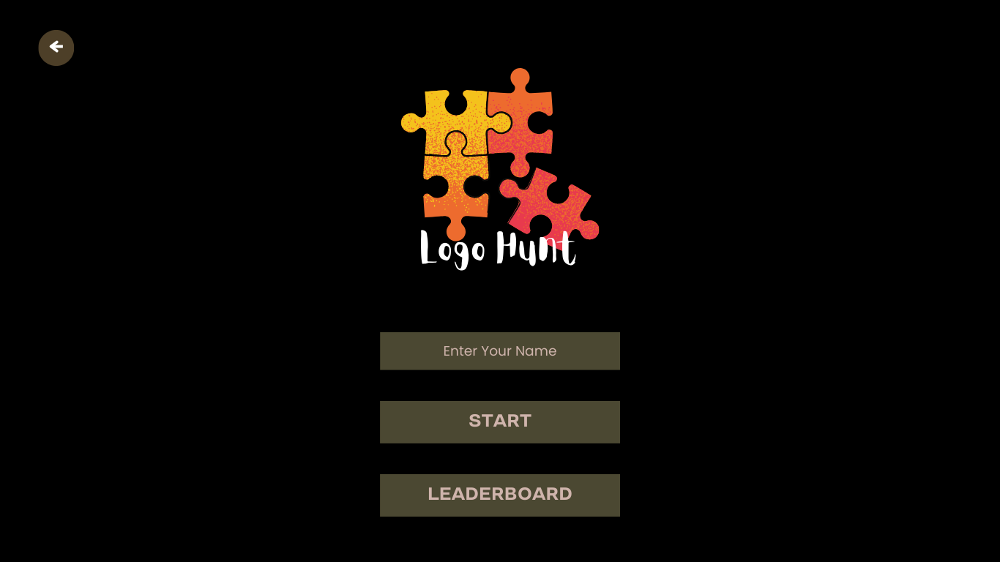
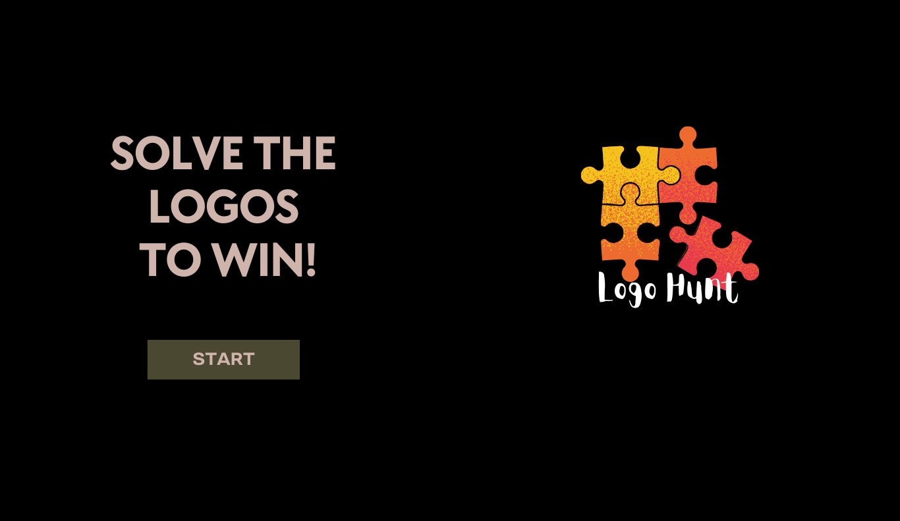
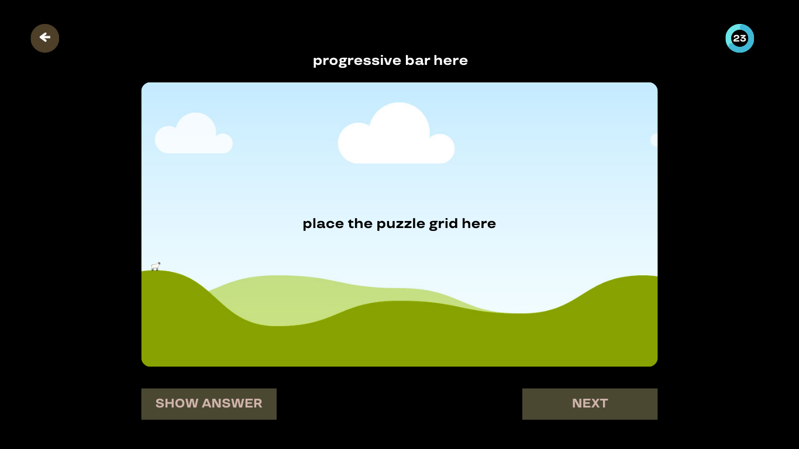
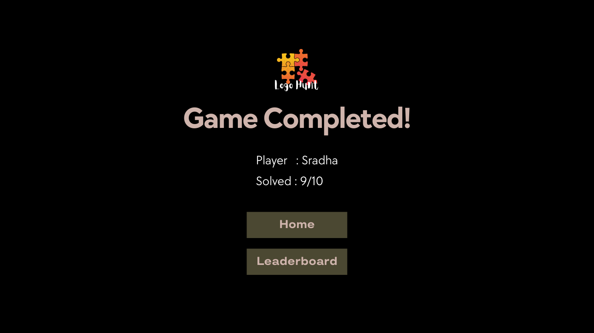
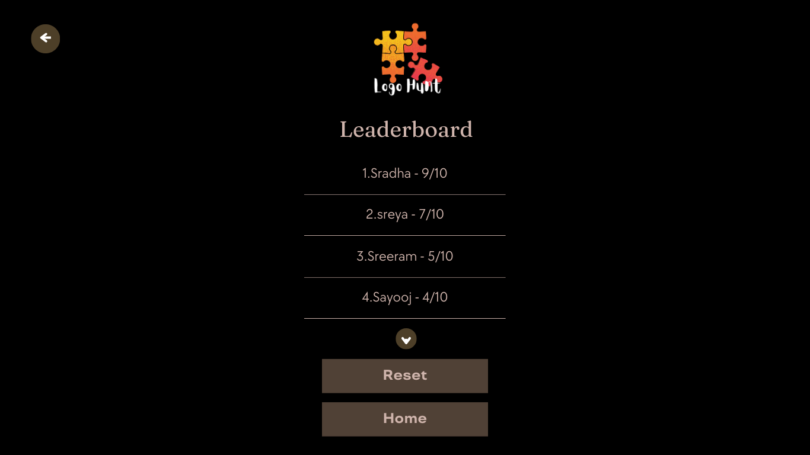

# LogoHunt 🎮

LogoHunt is an interactive React-based puzzle game where users solve shuffled logo puzzles by rearranging pieces correctly.

Built using React and Vite, the project focuses on frontend development, component-based architecture, and interactive UI design.

## Features

* Interactive puzzle gameplay
* Dynamic piece movement
* Responsive UI
* React state management
* Fast Vite development environment

## Technologies Used

* React
* Vite
* JavaScript
* HTML
* CSS

## Project Structure

```bash id="yf1"
src/
├── assets/
├── App.jsx
├── main.jsx
├── App.css
├── index.css
```

## Screenshots

### Start Page


### Home Page


### Puzzle Page


### Completed Page


### Leaderboard Page


## How to Run

Clone the repository:

```bash id="yf2"
git clone https://github.com/Sradha-Sivadas/logohunt.git
```

Install dependencies:

```bash id="yf3"
npm install
```

Start development server:

```bash id="yf4"
npm run dev
```

## Author

Sradha S
